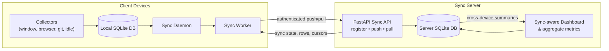

# Sync Docs

This folder contains implementation and operations documents for WorkGraph multi-device sync.

## Sync Architecture

	## Entity Configuration

	The shared allowlist is `../../config/sync.yaml`. The worker and API load its
	entity definitions at runtime; adding a table that follows the configured UUID,
	timestamp, soft-delete, and user/device ownership contract does not require an
	entity-specific sync implementation. Clients still need the table schema and
	feature code installed. The server stores generic payloads in the shared change
	stream, while configured legacy projections preserve existing session metrics.

	Push and pull requests advertise the client manifest. A mismatch is rejected
	with HTTP 409 rather than allowing a client to advance its cursor past an entity
	it cannot handle. Deploy matching manifest changes to the server and clients
	together before enabling a new entity.

## Documents

- [MULTI_DEVICE_SETUP.md](MULTI_DEVICE_SETUP.md): practical setup steps for Raspberry Pi sync server and multiple client devices.
- [SERVER_AGGREGATE_METRICS_APPROACH.md](SERVER_AGGREGATE_METRICS_APPROACH.md): implemented approach and current behavior for computing dashboard metrics from synced multi-device server data.
- [SYNC_HARDENING_LAUNCH.md](SYNC_HARDENING_LAUNCH.md): implemented hardening summary, resilience guarantees, and pre-launch test checklist.
- [JOURNAL_SYNC_CURSOR_RECOVERY.md](JOURNAL_SYNC_CURSOR_RECOVERY.md): runbook for recovering missing journal entries caused by cursor ordering gaps.
- [../operations/README.md](../operations/README.md): architecture diagrams, sync lifecycle, troubleshooting, deployment, and upgrade notes.

## Suggested Additions

- `API_CONTRACT.md`: endpoint examples and error model.
- `OPERATIONS.md`: deployment/runbook for Raspberry Pi sync service.
- `TEST_PLAN.md`: integration and load test scenarios.
